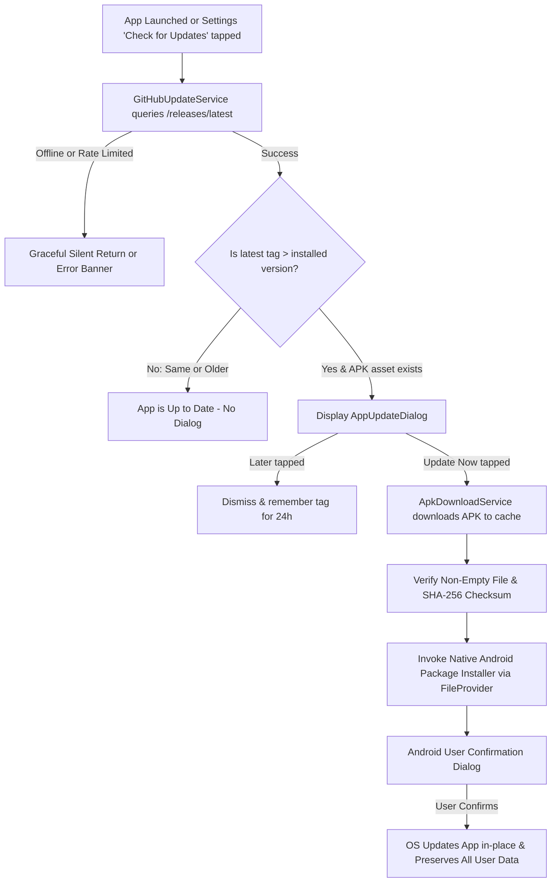

# Android In-App Updates via GitHub Releases

**Application:** Rise for Prayer (ለጸሎት ተነሱ)  
**Package Name:** `com.example.thelot_2`  
**GitHub Repository:** [fraoldirirsa2-dev/RISE-FOR-PRAYER](https://github.com/fraoldirirsa2-dev/RISE-FOR-PRAYER)

---

## 1. System Architecture Overview

This update system provides direct, user-confirmed over-the-air (OTA) APK updates for users who install the app directly from GitHub Releases.



### Components
1. **`AppVersion` & `AppUpdateInfo`** (`lib/core/app_update/models/app_update_info.dart`):
   - Semantic version parsing supporting `v1.2.0`, `1.2.0+2`, build numbers, and numerical comparisons (e.g. `1.10.0 > 1.9.0`).
2. **`GitHubUpdateService`** (`lib/core/app_update/services/github_update_service.dart`):
   - Queries `https://api.github.com/repos/fraoldirirsa2-dev/RISE-FOR-PRAYER/releases/latest`.
   - Parses the release tag, release notes, APK binary asset, size, and optional SHA-256 digest.
   - Ignores draft or prereleases.
3. **`ApkDownloadService`** (`lib/core/app_update/services/apk_download_service.dart`):
   - Streams APK download into app-specific temporary cache directory.
   - Cleans old cached APKs to conserve device disk space.
   - Calculates SHA-256 checksum to verify package integrity.
   - Launches Android's system package installer using `FileProvider` via native `MethodChannel`.
4. **`AppUpdateController`** (`lib/core/app_update/controllers/app_update_controller.dart`):
   - Riverpod / `ChangeNotifier` state manager.
   - Enforces a 24-hour check throttling interval on app startup to prevent API spam.
   - Tracks download progress, status messages, and error states.
   - Remembers dismissed optional releases in `SharedPreferences`.
5. **`AppUpdateDialog`** (`lib/core/app_update/widgets/app_update_dialog.dart`):
   - Liturgical theme (burgundy, antique gold, Ethiopian typography).
   - Shows current version vs new version, release notes, download progress bar, and bilingual (Amharic & English) copy.
   - Supports explicit `[MANDATORY]` or `[REQUIRED]` flags in release notes.

---

## 2. Release Signing & Android Keystore

> [!IMPORTANT]
> **Android Signature Matching Requirement:**  
> Android will **only** update an existing installation if the new APK is signed with the **exact same signing certificate** as the currently installed APK. If the keys differ, Android displays: *"App not installed as package appears to be invalid or conflicting signatures."*

### Keystore Configuration
The project uses `android/key.properties`:
```properties
storePassword=YOUR_STORE_PASSWORD
keyPassword=YOUR_KEY_PASSWORD
keyAlias=upload
storeFile=../upload-keystore.jks
```

### Setting up CI Release Signing on GitHub Actions
To have GitHub Actions sign releases with your official keystore:
1. Base64-encode your keystore:
   ```powershell
   [Convert]::ToBase64String([IO.File]::ReadAllBytes("upload-keystore.jks")) | Set-Clipboard
   ```
2. In your GitHub repository:
   - Go to **Settings** ➔ **Secrets and variables** ➔ **Actions**.
   - Create a Secret named `KEYSTORE_BASE64` and paste the base64 string.
   - Create a Secret named `KEY_PROPERTIES` containing the 4 lines of `android/key.properties`.

The workflow (`.github/workflows/release-android.yml`) automatically detects these secrets and signs production APKs.

---

## 3. Step-by-Step: How to Publish an App Update

### Step 1: Implement & Test Changes
Verify everything compiles and tests pass:
```bash
flutter test
flutter analyze
```

### Step 2: Bump the Version Number in `pubspec.yaml`
Update the version string. **Always increment both the version and build number**:
```yaml
# Example: Upgrading from 1.0.0+1 to 1.1.0+2
version: 1.1.0+2
```

### Step 3: Commit and Tag
```bash
git add pubspec.yaml
git commit -m "Release v1.1.0"
git tag v1.1.0
git push origin main
git push origin v1.1.0
```

### Step 4: GitHub Actions Builds & Publishes
- GitHub Actions detects tag `v1.1.0`.
- Builds `app-release.apk`.
- Generates `app-release.apk.sha256`.
- Creates a GitHub Release under `v1.1.0` with the attached APK assets.

---

## 4. Testing Updates on Real Android Devices

### Checklist:
1. **Install Base Version (e.g., v1.0.0):**
   - Install `v1.0.0` APK onto test device using `adb install app-release-1.0.0.apk`.
   - Complete onboarding, select preferred language, toggle completed prayers, check calendar.
2. **Publish or Mock v1.1.0:**
   - Publish `v1.1.0` on GitHub Releases with attached `app-release.apk`.
3. **Trigger Update Check:**
   - Open the app. The update dialog should pop up automatically.
   - Alternatively, open **Settings** ➔ tap **Check for Updates (ማሻሻያ ፈልግ)**.
4. **Download and Install:**
   - Tap **Update Now (አሁን አዘምን)**.
   - Watch the progress bar stream MB received.
   - When prompted by Android ("Install unknown apps"), grant permission for Rise for Prayer.
   - Tap **Update** on the system installer prompt.
5. **Verify Data Persistence:**
   - App relaunches on version `1.1.0`.
   - Verify settings, prayer history, streaks, and bookmarks are 100% intact.

---

## 5. Google Play Store vs GitHub Direct APK Distribution

| Feature | GitHub Direct APK (Current) | Google Play Store |
| :--- | :--- | :--- |
| **Distribution** | Direct download from GitHub Releases | Google Play Store client |
| **Permissions** | `REQUEST_INSTALL_PACKAGES` required | Managed via Google Play Core API |
| **Installation** | System package installer prompt | In-App Update API (`in_app_update` package) |
| **Policy Note** | Perfect for direct / open-source distribution | Play Store prohibits apps installing APKs directly outside Google Play |

If you ever decide to publish to Google Play in the future, remove `REQUEST_INSTALL_PACKAGES` from `AndroidManifest.xml` and switch to Google Play In-App Update API.
